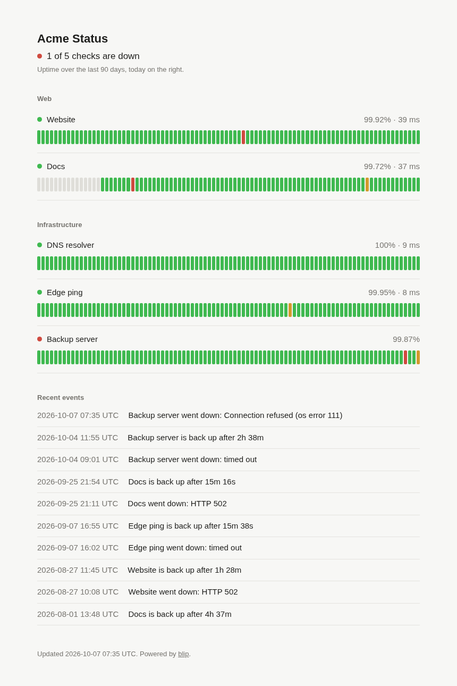
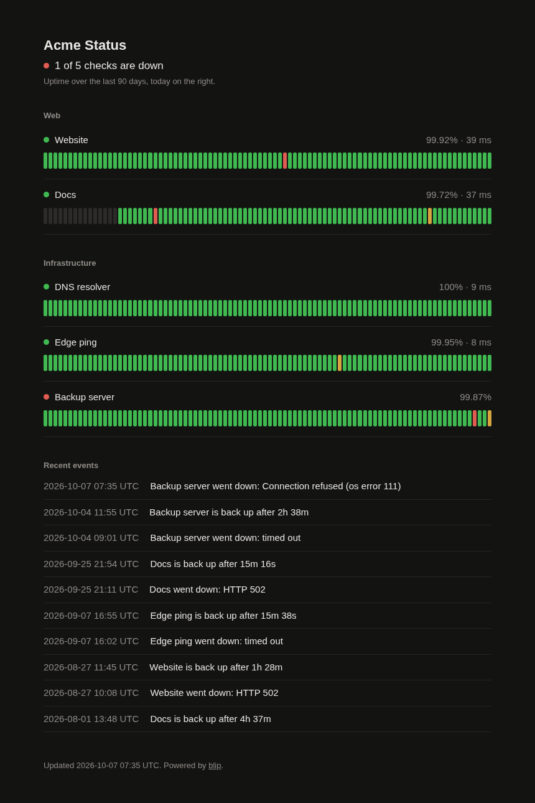
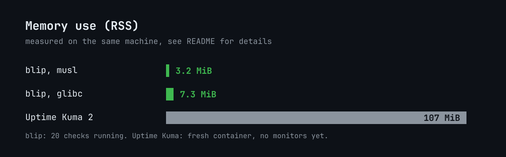

<p align="center"></p>

<p align="center">
  <a href="https://github.com/luxend1337/blip/stargazers"></a>
  <a href="https://github.com/luxend1337/blip/releases"></a>
  <a href="https://github.com/luxend1337/blip/actions/workflows/ci.yml"></a>
  <a href="LICENSE"></a>
</p>

blip watches your websites, ports and hosts and serves a status page. It is a
single static binary with SQLite built in. There is nothing to install next to
it: no runtime, no database server, no node_modules.

It is meant to be small enough that you never think about where to run it.
A spare corner of any VPS, a Raspberry Pi or a 64 MB container is plenty.

<p align="center">
  
  
</p>

## Numbers

Measured on x86_64 Linux with blip 0.1.0. RSS is read from `/proc/<pid>/status`
after five minutes of running, with the status page loaded 50 times in between.
The 20 checks were a mix of HTTPS, TCP, ping and DNS on a 30 second interval.

| | static (musl) | glibc |
|---|---|---|
| binary size | 2.4 MiB | 2.2 MiB |
| RSS, 1 check | 2.5 MiB | 5.9 MiB |
| RSS, 20 checks | 3.2 MiB | 7.3 MiB |
| CPU, 20 checks | ~0.04 % of one core | ~0.04 % of one core |

The glibc build looks bigger in memory mostly because the shared libc counts
towards its RSS. The release binaries are the static musl ones.

For comparison, a fresh Uptime Kuma 2 container with no monitors configured
sat at 107 MiB on the same machine (`docker stats`).

<p align="center"></p>

That isn't a knock on Kuma, which does a lot more. If you want a web UI to
click monitors together, maintenance windows and 90 notification providers,
use Kuma. If you want a config file and a status page, blip is enough.

## What it does

- HTTP(S) checks with an expected status code and an optional keyword in the body
- TCP port checks
- ICMP ping, without root (see below)
- DNS resolution checks
- Retries before anything is marked down, so one lost packet doesn't page you
- Notifications on down and recovery: generic webhook, Discord, Telegram
- Status page with 90 days of history, light and dark, no JavaScript
- `/api/status` as JSON and `/healthz` for your own monitoring
- History is stored per hour, so the database stays a few hundred KB

What it doesn't do: there is no web UI for editing, no user accounts, no
email (use the webhook with something that sends mail). That is on purpose.

## Quick start

Grab a binary from the [releases](https://github.com/instantnode/blip/releases),
or build it yourself:

```sh
cargo build --release
cp blip.conf.example blip.conf
./target/release/blip blip.conf
```

Then open http://127.0.0.1:8080.

`blip -t blip.conf` checks the config without starting anything.

### systemd

```sh
install -m 755 blip /usr/local/bin/
mkdir -p /etc/blip && cp blip.conf /etc/blip/
cp contrib/blip.service /etc/systemd/system/
systemctl enable --now blip
```

The unit runs blip as a dynamic user with its database in `/var/lib/blip`,
so set `db = blip.db` (relative) in the config.

### Docker

```sh
docker build -t blip .
docker run -d -p 8080:8080 -v $PWD:/data blip
```

The image is `FROM scratch` with nothing but the binary. Use
`listen = 0.0.0.0:8080` in the config so the port is reachable from outside
the container. blip runs as uid 65534 inside, so the mounted directory has to be
writable for it to create the database.

## Config

A plain `key = value` file. Lines starting with `#` are comments.

```ini
title = Status
listen = 127.0.0.1:8080
db = blip.db
keep_days = 90

[notify]
webhook = https://example.com/hooks/blip
discord = https://discord.com/api/webhooks/123/abc
telegram_token = 123456:ABC-DEF
telegram_chat = -1001234567890

[check "Website"]
url = https://example.com
group = Web
keyword = Example Domain

[check "Database"]
url = tcp://10.0.0.5:5432
interval = 30s
retries = 1
```

### Global

| key | default | |
|---|---|---|
| `title` | `Status` | page title |
| `listen` | `127.0.0.1:8080` | address for the status page |
| `db` | `blip.db` | SQLite file, created if missing |
| `keep_days` | `90` | history older than this is deleted |

### Checks

Each `[check "name"]` section is one monitor. The name shows up on the status
page and in notifications, and has to be unique. The kind of check comes from
the url:

| url | checks |
|---|---|
| `https://host/path` | HTTP status, optionally a keyword |
| `tcp://host:port` | that the port accepts a connection |
| `ping://host` | ICMP echo |
| `dns://host` | that the name resolves |

| key | default | |
|---|---|---|
| `url` | | required |
| `group` | none | checks with the same group are listed together |
| `interval` | `60s` | time between checks, `30s`, `5m`, `1h` |
| `timeout` | `10s` | |
| `retries` | `2` | failed attempts before the check counts as down |
| `retry_interval` | `20s` | wait between retries, at most `interval` |
| `expect` | any status below 400 | exact HTTP status to expect |
| `keyword` | | text that must appear in the response body |

Redirects are followed. Attempts that fail while a check is still retrying
don't count against its uptime; only confirmed outages do.

### Notifications

Everything under `[notify]` is optional. A message goes out when a check is
confirmed down and again when it recovers, with how long it was down.

The webhook gets a JSON body like this:

```json
{"check":"Website","group":"Web","status":"down","message":"Website is down: HTTP 502","time":1791374580}
```

### Ping without root

blip uses unprivileged ICMP sockets, so it doesn't need root or
`CAP_NET_RAW`. The kernel only allows that for groups listed in
`net.ipv4.ping_group_range`. Most distributions open it for everyone already;
if ping checks fail with "ping not allowed", run

```sh
sysctl -w net.ipv4.ping_group_range="0 2147483647"
```

and put it in `/etc/sysctl.d/` to keep it.

## API

`GET /api/status`

```json
{
  "title": "Status",
  "status": "up",
  "checks": [
    {"name": "Website", "group": "Web", "status": "up", "latency_ms": 38,
     "last_check": 1791374580, "uptime_24h": 100.000, "uptime_90d": 99.920, "error": null}
  ]
}
```

`status` is `up`, `down` or `pending` (no result yet). `GET /healthz` returns
`ok` as long as blip is running.

## Building small

The size comes from a few choices you can see in `Cargo.toml` and
`.cargo/config.toml`: no async runtime (one thread per check, sleeping most of
the time), a handwritten HTTP server, rustls with ring instead of OpenSSL,
SQLite compiled without the extensions blip doesn't use, and the ASCII-only
IDNA backend. Internationalised domain names have to be written in punycode
(`xn--...`) because of that last one.

## License

MIT. Made by [InstantNode](https://instantnode.eu).
